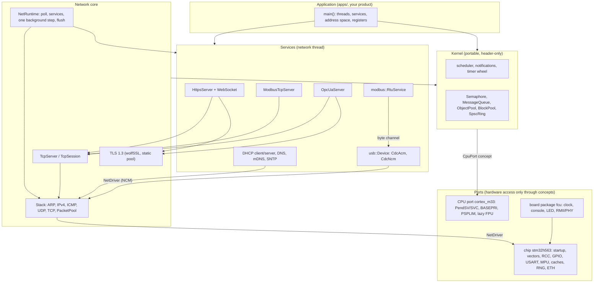
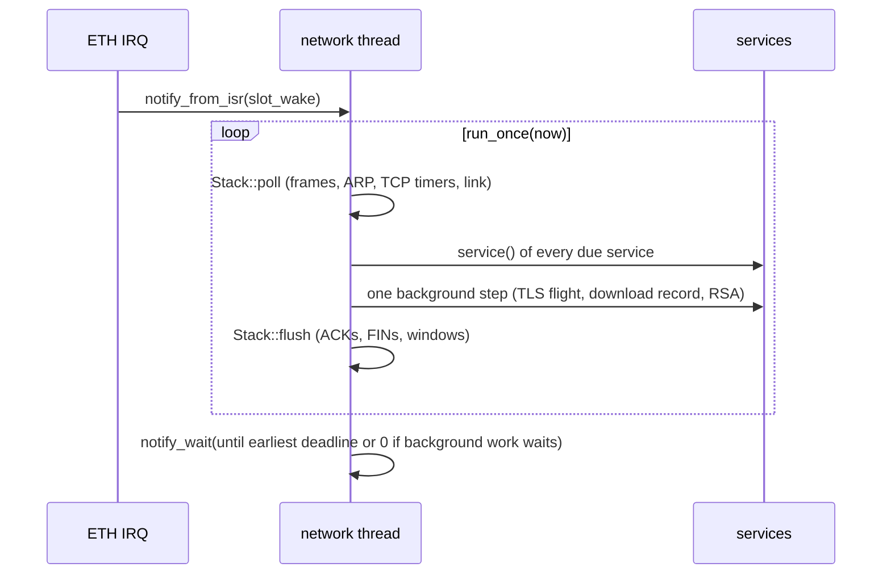

# Architecture

rtoos is a set of C++26 libraries. Most of it is header-only. A firmware image is an ordinary `main()` that creates the kernel, the threads and the services it needs. Nothing is allocated at run time: every thread stack, packet buffer, TLS pool and session table is a static object whose size is fixed at compile time.

## Layers



| Layer | Directory | Depends on hardware? |
|---|---|---|
| Kernel | `include/rtos/`, `include/rtos/kernel/`, `include/rtos/sync/` | no: the CPU is a template parameter (`rtos::CpuPort` concept) |
| Network | `include/rtos/net/`, `src/net/` | no: drivers satisfy `NetDriver` |
| Modbus | `include/rtos/modbus/` | no |
| OPC UA | `include/rtos/opcua/`, `src/opcua/` | no |
| USB | `include/rtos/usb/` | no: the controller satisfies `DeviceController` |
| CPU port | `port/cortex_m33/` | Cortex-M33 core |
| Chip | `port/stm32h563/` | STM32H563 peripherals, linker script, startup |
| Board | `boards/fcu/` | the FCU's pins, clock and PHY |

Everything above the ports is the same code on the host and on the target. The host tests instantiate the kernel with a `MockPort`, connect the IP stack to simulated wires and drive the USB stack from a simulated host. On the target the same templates are instantiated with `Cm33Port`, the ETH driver and (later) the USB controller driver.

## Threads and interrupts

A typical network firmware (see [`apps/net`](../apps/net/main.cpp)) has very few threads:

| Context | Runs |
|---|---|
| network thread (one) | `NetRuntime::run_once()`: receives frames of all interfaces, runs every service (DHCP, DNS, mDNS, SNTP, HTTPS, Modbus TCP, OPC UA, USB device, Modbus RTU, your own), runs one background step, flushes |
| application threads | control loops, sensors, actuators; they exchange data with the services through shared, locked data (e.g. the Modbus `RegisterBank`) or messages |
| kernel-aware ISRs (priority ≥ `RTOS_CM33_KERNEL_PRIORITY`) | drivers; they wake the network thread with `notify_from_isr` |
| zero-latency ISRs (priority < kernel priority) | never masked by the kernel; they may only use the lock-free services |
| idle thread | owned by the kernel |

The network thread needs no locks: the stack, all services and the TLS sessions belong to it alone. Fairness between the services is a scheduling problem inside this one thread and is solved there (see [Networking: fairness](networking.md#fairness-in-one-thread)).



## Memory model

- **No heap.** `malloc` is not linked. wolfSSL runs with `WOLFSSL_STATIC_MEMORY` from a pool that the application passes in. Its bucket layout comes from measurements ([decisions](decisions.md#wolfssl-pool-sized-from-measurements)).
- **DMA memory.** The linker script has a 64 KB region `RAM_DMA` (0x20090000) that the MPU makes non-cacheable. Objects that a DMA engine touches carry `RTOS_DMA_BUFFER`: the packet pool, the Ethernet descriptors and any application DMA target.
- **Zero-copy packets.** Every transmit buffer comes from `Stack::allocate()` with 64 bytes of headroom. Each layer prepends its header with `push_front` instead of copying the payload.
- **Stacks.** Thread stacks are static arrays. PSPLIM guards them on the hardware and in QEMU. Renode does not enforce PSPLIM, so stacks are sized from the frames of the deepest path (`arm-none-eabi-objdump -d`, `sub sp`), not only from stack painting.
- **Contracts.** Preconditions are C++26 contracts. The host uses the `enforce` semantic, the target uses `quick_enforce` (trap without library code).

Static RAM of the full example `fcu_net` (HTTPS with 6 sessions, Modbus TCP, OPC UA with 2 sessions and subscriptions): about 217 KB in `RAM` plus 52 KB in `RAM_DMA` (packet pool and descriptors), out of 640 KB. Flash: about 395 KB, of which 100 KB is the throughput test blob.

## Source tree

```
include/rtos/            kernel (portable, no registers), config.hpp, rtos.hpp
include/rtos/kernel/     scheduler internals: ready queue, wait queues, timer wheel
include/rtos/sync/       Semaphore, MessageQueue, ObjectPool, BlockPool, SpscRing
include/rtos/log/        log journal, RTOS_LOG_* macros, console format
include/rtos/motion/     stepper moves with a compile-time sigmoid ramp
include/rtos/net/        IP stack, DHCP, DNS, mDNS, SNTP, TLS, HTTP, WebSocket, HTTPS,
                         TcpServer, NetRuntime, Modbus TCP and OPC UA transports
include/rtos/modbus/     Modbus PDU, RegisterBank, RTU framing, RtuService
include/rtos/opcua/      OPC UA: codec, secure channel, sessions, services, subscriptions,
                         address space, Modbus register binding
include/rtos/usb/        USB device core, descriptors, CDC-ACM, CDC-NCM
src/net/, src/opcua/     the compiled parts (wolfSSL glue, OPC UA)
port/cortex_m33/         CPU port
port/stm32h563/          chip: startup, vectors (generated from the SVD), linker script, drivers
boards/fcu/              board package of the Factory Control Unit
apps/                    examples: demo, selftest, net (fcu_net), bench
web/                     the web app of fcu_net (brotli-compressed and embedded with #embed)
tests/                   host tests (GoogleTest), mock port, fixtures, fuzzers
emulation/               QEMU machine "fcu", Renode platform, runners, network test
tools/                   vector generator, CA and certificate tools, open62541 catalog
cmake/                   toolchain files, wolfSSL build
third_party/wolfssl/     wolfSSL configuration (user_settings.h); the sources are fetched
```
